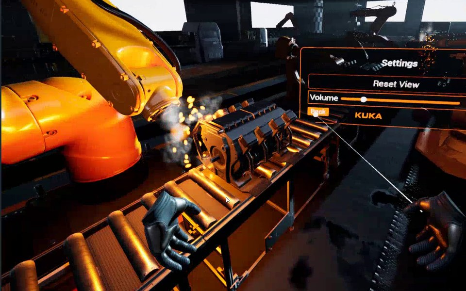

# PUREVR – VR training simulator for a KUKA industrial robot

PUREVR is a virtual reality training simulator for a KUKA industrial robot, built with
Unreal Engine 5.6 as a university project at Hochschule Düsseldorf (PURE3D course).

In VR, trainees learn how to operate the robot step by step:

- **Introduction:** the robot's axes and their limits, shown with interactive rotation gizmos
  (green = safe, yellow = near the limit, red = out of range).
- **Basics:** play back programmed movements from a virtual tablet.
- **Advanced:** program your own movement in 3D with waypoints and inverse kinematics.
- **Final task:** move a box from one zone to another with the robot.

Also included: swappable robot attachments (grippers), safety zones, keyframe animation
of the robot, and a main menu with training modules and settings.

## Contents of this repository

This public repository contains the C++ source code, the project configuration, our own
Blueprints and UI widgets, and the software architecture diagram (`_softwareArchitecture`).

Third-party content is **not** included because of its licenses: Fab and Megascans assets,
the BlenderKit robot model, Epic Starter Content and templates, textures, fonts and the
maps that depend on them. The project will therefore not open as a complete scene.

## Team

- Marcel Kazemi
- Walter Kusnezow
